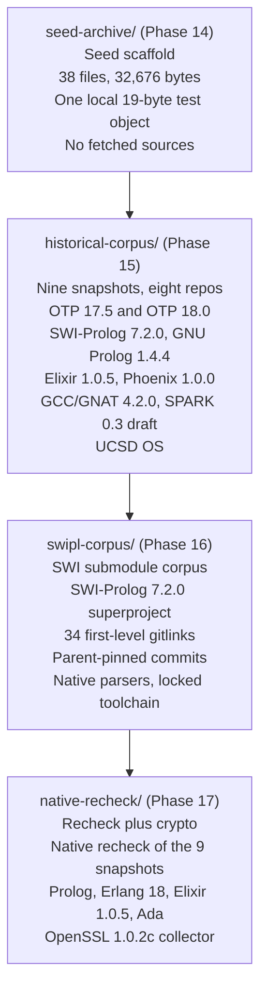
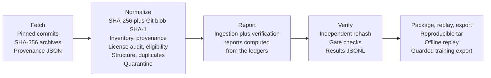
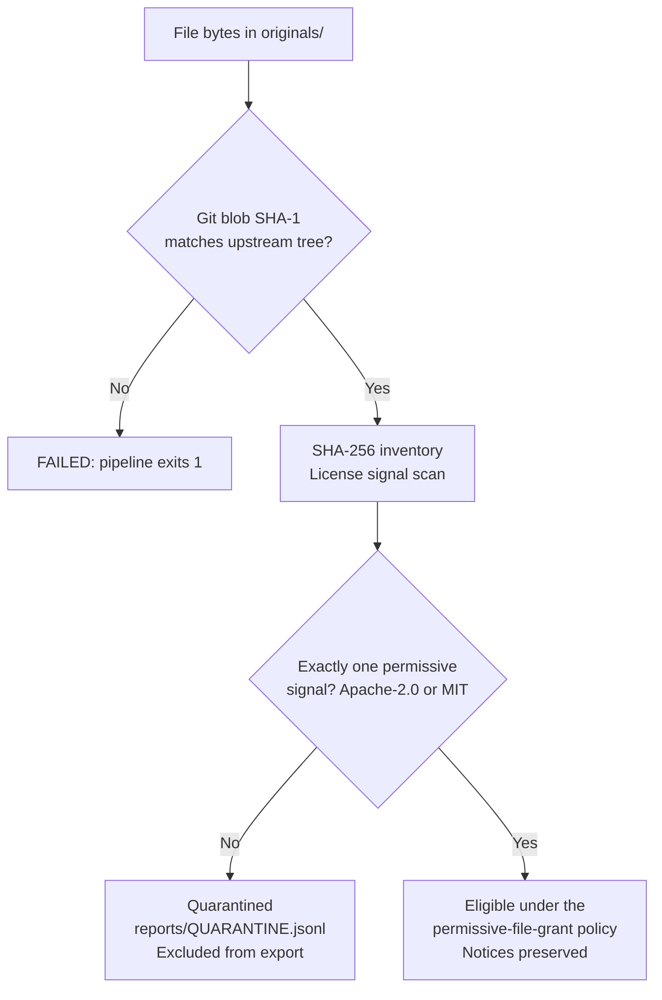

# legacy-logic-archive

[](LICENSE)
[](https://www.perl.org/)
[](https://pubs.opengroup.org/onlinepubs/9699919799/utilities/V3_chap02.html)
[](https://www.swi-prolog.org/)
[](https://www.erlang.org/)
[](https://elixir-lang.org/)
[](https://gcc.gnu.org/wiki/GNAT)

**What this is:** a verified archive of historical logic-programming source code — Prolog, Erlang, Elixir, Ada, Pascal, and C — where every byte is hash-checked against its pinned upstream commit.

I built this to answer one question honestly: can you reconstruct a historical corpus from upstream sources, and prove every byte came from where it claims to?

No scraped blobs. No "trust me" manifests. Every file gets a SHA-256 identity, a Git blob SHA-1 checked against the commit-pinned upstream tree, a provenance record, a per-file license verdict, and a place in either the training-eligible set or quarantine. If any check fails, the pipeline exits 1. That is the whole system.

## Demo: the system in this checkout

This repo is code plus provenance logic — the corpus bytes themselves are fetched, not committed. But the verification machinery runs right now, on a fresh checkout, with no data:

```sh
# Every script parses. No exceptions.
$ for f in historical-corpus/bin/*.pl swipl-corpus/bin/*.pl native-recheck/bin/*.pl; do perl -c $f; done
historical-corpus/bin/audit-seed-archive.pl syntax OK
historical-corpus/bin/normalize.pl syntax OK
# ... every Perl file, every directory

$ for f in historical-corpus/bin/*.sh swipl-corpus/bin/*.sh native-recheck/bin/*.sh; do sh -n $f; done
# ... every shell script, every directory

# The structural extractor's test suite
$ perl historical-corpus/tests/structure.t
1..12
ok 12 - C literal dependency extraction

# The Erlang native parser compiles
$ erlc -o /tmp swipl-corpus/native/parse_erlang.erl
$ erlc -o /tmp native-recheck/native/recheck_erlang18.erl
```

A full run — fetching, normalizing, reporting, verifying — needs the populated `evidence/`, `originals/`, and `downloads/` directories plus the historical toolchains. The run order, per directory:

```sh
cd historical-corpus && perl bin/normalize.pl && perl bin/report.pl && perl bin/verify.pl
cd swipl-corpus && perl bin/normalize.pl && perl bin/report.pl && perl bin/verify.pl
cd native-recheck && sh bin/recheck-parsers.sh && perl bin/report.pl && perl bin/verify-native-recheck.pl
```

## The corpus



**seed-archive/** (Phase 14) is the seed: a content-addressed archival scaffold for JOVIAL, ALGOL, COBOL II, and Prolog. It holds collector code and one local test object (`parent(alice,bob).`, 19 bytes) — no fetched historical sources. Everything later is checked against these pristine bytes, which are never modified.

**historical-corpus/** (Phase 15) is the first real corpus: nine snapshots across eight repositories (OTP contributes two releases). Every snapshot is a pinned commit with a recorded archive SHA-256, an independent Git-tree evidence file, and per-path inventory. SWI-Prolog's 34 gitlinks are recorded but *not* fetched here — this is a verified superproject corpus, not a dependency closure.

**swipl-corpus/** (Phase 16) finishes that job for SWI: it locks all 34 first-level gitlinks at the commits pinned by the parent superproject (parent `6442d29038b0e1ed413e2f1dfe8086b812777e7d`), fetches them, assembles SWI-Prolog 7.2.0 from the superproject plus submodules, and runs native parsers (SWI `read_term`, Erlang `epp_dodger`, Elixir `Code.string_to_quoted`, GNAT syntax-only) over the corpus. The modern toolchain is locked too: every build tool must match the signed Debian package-index SHA-256. Nested gitlinks below the 34 are still not fetched — this is a verified first-level corpus, not a complete dependency closure.

**native-recheck/** (Phase 17) rechecks the nine-snapshot corpus with native parsers and adds the OpenSSL 1.0.2c collector. The recheck classifies every Phase 16 parser outcome against a fresh native run, so a failure is evidence, not an error to paper over.

## How a run works



**Fetch** downloads each snapshot at its pinned commit, records the archive SHA-256, and writes a provenance record (commit, tag, URL, UTC timestamps, tree evidence). **Normalize** walks every file, verifies its Git blob SHA-1 against the upstream tree, hashes it, classifies its language, extracts partial structure, and writes the ledgers: `SOURCE_INVENTORY.jsonl`, `PROVENANCE_MANIFEST.jsonl`, `LICENSE_AUDIT.jsonl`, `TRAINING_ELIGIBILITY.jsonl`, plus `reports/DUPLICATES.jsonl` and `reports/QUARANTINE.jsonl`. Normalized derivatives go to `normalized/sha256/` (strict UTF-8, LF line endings, no semantic rewriting). **Report** builds the ingestion, verification, and handoff reports from the ledgers — no hardcoded counts. **Verify** independently rehashes everything and runs the gate checks. **Package / replay / export** produce a reproducible tarball, replay a run into a fresh directory from stored hashes, and export a guarded training subset.

The verifiers are independent: they recompute hashes from the original bytes rather than trusting the normalizer's output. The gate names tell the story:

- Historical corpus: `independent_file_bytes_and_git_blobs`, `license_evidence_integrity`, `training_partition`, `exact_totals`, `duplicates`, per-snapshot version and license gates, `phase14_preserved`
- SWI-Prolog corpus: the same core gates, plus `exact_pinned_swi_dependency_closure`, `phase15_manifests_preserved`, `native_toolchain_package_hashes`, `native_parser_source_and_artifact_links`, `historical_swi_executable_examples`, `native_parser_adversarial_fixtures`
- Native recheck: `strict_jsonl_deliverables`, `baseline_failure_classification`, `native_source_and_artifact_hashes`, `parser_aggregate`, `offline_source_replay`, `baseline_ledgers_preserved`, `runtime_hashes`, `unmodified_openssl_failure_visible`

## How a file gets cleared — or quarantined



A root license is never enough. Eligibility requires a verified blob, exactly one file-level permissive signal, a source language, and a clean path — no `vendor/`, `third_party/`, `test/`, or `fixtures/` contexts, no UCSD OS (restricted purpose), no unresolved `Perl_or_Prolog` ambiguity. Everything else is quarantined, and quarantine is enforced by `export-training.pl`: only allowlisted files can enter a training export.

Manual review can override in either direction. In the SWI-Prolog corpus, two files were reclassified by review: their full notices carry an additional Groupe Bull name-use clause, so they are not the exact MIT template. Overrides live in `evidence/LICENSE_REVIEW_OVERRIDES.jsonl`, in the open, not in a silent edit.

Eligibility is a policy decision about permissive use — not an express AI-training clause and not a jurisdiction-independent legal authorization. Nothing here is publicly redistributed on the strength of this pipeline alone.

## Layout

```
seed-archive/        Seed scaffold + 38 pristine originals (never modified)
  bin/                 Collectors and verifier (expanded copies)
  legacy-logic-archive/  Pristine originals, byte-identical
historical-corpus/   Nine snapshots, eight repos
  bin/                 Normalize, report, verify, package, replay,
                       audit, supplement, export, check-examples
  tests/               structure.t
swipl-corpus/        SWI submodule corpus + native parsers
  bin/                 Lock, fetch, assemble, normalize, attach-native,
                       verify, package, replay, builders, toolchain
  bin/native/          Toolchain wrappers (erl, erlc, gnatmake)
  native/              parse_prolog.pl, parse_erlang.erl, parse_elixir.exs
  tests/               Fixtures, adversarial cases, native-fixtures.t
native-recheck/      Native recheck + OpenSSL
  bin/                 fetch-corpus.pl, fetch.pl (OpenSSL), normalize,
                       recheckers, classifiers, verifiers, package,
                       builders, replay, report
  native/              Prolog registry/parser, Erlang/Elixir rechecks
  tests/               Prolog fixtures and fixture generator
  patches/             openssl-cms-historical-time.patch
```

Each directory has its own README. Directories are named by what they hold; the `phase15/` / `phase16/` strings that remain in the code are record-ID prefixes in ledger data (for example `phase16/<snapshot>:<path>`), deliberately unchanged because the parser overlays, recheckers, and verifiers join on those IDs. The same goes for policy strings (`phase15-permissive-file-grant-v1`), gate names (`phase14_preserved`), and report titles — those are historical labels, not paths.

Three files in `swipl-corpus/bin/` are assistant-reconstructed, not user-supplied originals, and say so in-file and in their commit: `normalize.pl`, `report.pl`, `structure.pm`. `native-recheck/bin/fetch-corpus.pl` is the nine-target corpus fetcher; `native-recheck/bin/fetch.pl` is the separate single-target OpenSSL 1.0.2c collector. Replace any reconstruction with the original if it surfaces.

## Status: what is verified, what is partial

Verified in this checkout: every Perl file passes `perl -c`, every shell script passes `sh -n`, the Erlang parser compiles, `structure.t` runs 12/12, and the three reconstructed SWI-Prolog-corpus files were tested on synthetic fixture trees (hash/blob/totals recheck pass; missing-blob and mismatch fixtures exit 1). The seed archive is byte-identical to its supplied zip, and its verifier passes.

Not verified here: full pipeline execution. The historical builds, the corpus downloads, and the native parser runs need the populated data directories and historical toolchains, which are not in this checkout. The per-directory handoff reports say the same in their own words — core byte ingestion is independently verifiable; parser correctness, full historical builds, dependency closure, and manual licensing review remain open. I do not describe this as a fully compiled or universally training-cleared corpus.

## License

GNU GPL v3. See `LICENSE`.
